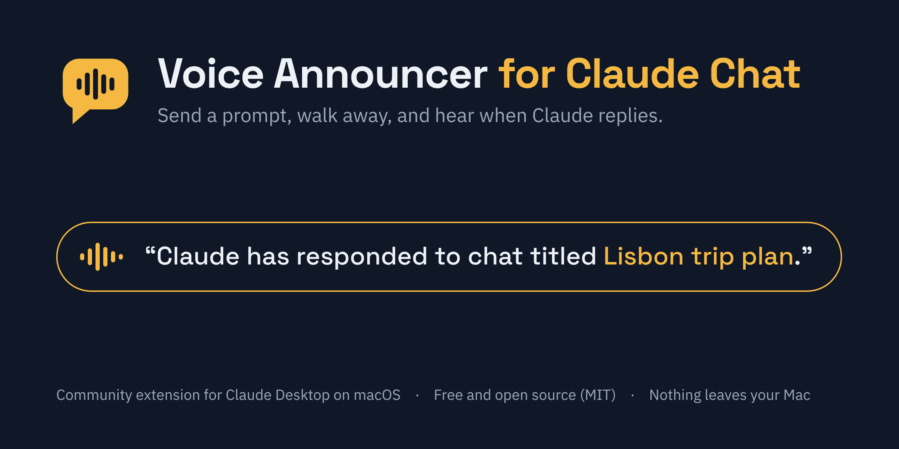
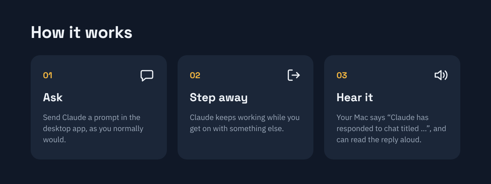

# Voice Announcer for Claude Chat

Send Claude a prompt, walk away, and your Mac tells you when the reply is ready.

- **Announce** (on by default): "Claude has responded to chat titled *Lisbon trip plan*." If Claude asked you something, it adds "It needs your input."
- **Read aloud** (off by default): reads the reply, and any questions Claude asked you, in plain spoken sentences. Long replies are shortened for listening; the full text stays in the chat.

It is a community extension for the Claude Desktop app on macOS. It isn't made or endorsed by Anthropic.



## Install

1. Download [`voice-announcer.mcpb`](voice-announcer.mcpb) on your Mac.
2. Double-click it, or in Claude Desktop open **Settings > Extensions > Advanced settings > Install Extension…** and choose the file. To update, install a newer file the same way; it replaces the old version and keeps your settings.
3. Pick your options on the settings screen, then click **Save** at the bottom (you may need to scroll down). You can change them later under **Settings > Extensions**.
4. Add this to your Claude preferences (Settings, in the box that asks what personal preferences Claude should consider in responses):

   > When a tool whose name ends in announce_reply (my Voice Announcer) is available, even if it's only listed as a deferred tool, load it if needed and call it once per reply as your last tool call, after all other work and right before you write your answer, then write the answer as usual. Use one short, consistent title for the chat, and set needs_input to true when your answer asks me something or needs my go-ahead. If no such tool is available, ignore this.

5. In a new chat, say "test the voice announcer". When Claude asks permission to use the tool, choose the option that always allows it, so it can speak while you're away.

## Settings

| Setting | What it does |
| --- | --- |
| Announce when Claude replies | Says "Claude has responded to chat titled …" |
| Read the reply aloud | Then reads the reply itself |
| Stop when I use the Mac | Stops speaking the moment you press a key, click, or move the mouse or trackpad (on by default) |
| Announcement wording | Your own wording; `{title}` becomes the chat title |
| Voice | A Mac voice such as Samantha, Daniel or Karen; blank uses the system voice |
| Speaking speed | Words per minute; 0 keeps the normal speed |
| Chime before speaking | Glass, Ping, Hero, Submarine, Tink, Pop, Purr, or `none` |
| Longest read-aloud | Word budget for read-aloud; 0 means no limit |

You can also just tell Claude, in any chat: "turn read-aloud on", "use the Daniel voice", "no chime". Those changes take effect at once and are saved; Claude confirms what changed. If you later change the extension's settings screen, that takes over.

To hear the voices your Mac has, run `say -v '?'` in Terminal. Better voices can be downloaded in **System Settings > Accessibility > Spoken Content > System voice > Manage Voices**.

## Good to know

- The Mac speaks only while it's awake and Claude Desktop is open.
- The title is the name Claude gives the chat. It stays the same within a chat but may not match your sidebar exactly.
- Touch the keyboard, mouse or trackpad to stop it mid-sentence, or say "stop talking" in any chat.
- An unknown voice falls back to the system voice, and an unknown chime is skipped. Both are noted in the extension's logs.

## How it works

The extension is a small [MCP](https://modelcontextprotocol.io) server packaged as a Claude Desktop extension ([MCPB](https://github.com/modelcontextprotocol/mcpb)). It gives Claude three tools:

- `announce_reply` queues a chime and the spoken text, and returns at once.
- `stop_speaking` stops whatever is playing and clears the queue.
- `voice_settings` shows or changes the settings when you ask Claude to.

Speech uses the Mac's built-in `say` command and the chime uses `afplay`; speech starts over the end of the chime so there's no gap. While it speaks, it checks the Mac's keyboard and mouse idle time (`ioreg`), which needs no special permission and reads no keystrokes, and stops as soon as you're active. The server is one readable file, [`server/index.js`](server/index.js), with no dependencies.

## Privacy and safety

Voice Announcer makes no network requests and collects, stores and shares nothing. The text Claude asks it to speak goes only to your Mac's built-in speech engine. See [PRIVACY.md](PRIVACY.md).

- **Anyone nearby can hear it.** Chat titles are spoken, and so are replies if read-aloud is on. Read-aloud is off by default. To keep titles private, change the announcement wording to leave out `{title}`.
- **No shell, no surprises.** It runs only the Mac's own `say`, `afplay` and `ioreg`, with fixed arguments and never through a shell. Text is passed to `say` on its input, with `say`'s embedded `[[…]]` commands removed.
- **Checked settings.** Voice names, chime names, numbers and text lengths are checked wherever they come from. Claude can change settings only to known values (it can't point the chime at an arbitrary file), and is told to do so only when you ask.
- **Readable code, no dependencies.** Everything is in [`server/index.js`](server/index.js).

## Develop

```bash
node test/run-tests.js                 # end-to-end tests with stand-ins for say/afplay
npx @anthropic-ai/mcpb@2.1.2 pack . voice-announcer.mcpb
```

The tests run on any system with Node 18 or later. Contributions and forks are welcome.

## License

[MIT](LICENSE) © 2026 Kiran Karthik Ponnusamy
